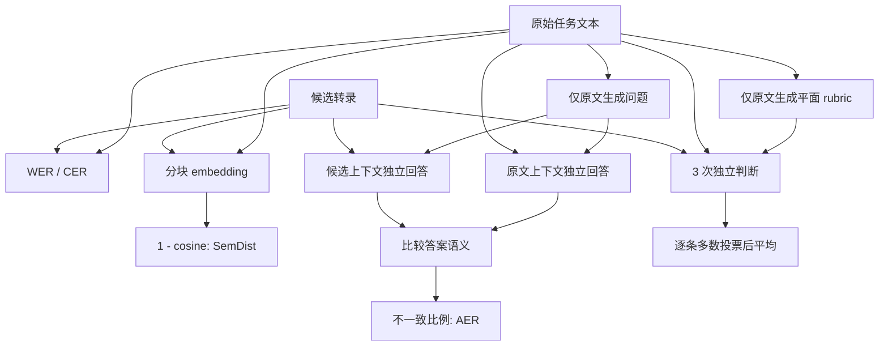

# Instruction baselines：实现与校准入口

实现三个独立baseline：SemDist-style embedding、AER-style QA、AASR-style atomic rubric；另提供WER/CER。它们只读任务文本，不运行WCB/OSWorld Agent。不复用Intent Retention的参考树、依赖图或评分结果生成baseline。

## 实现边界与来源

| 指标 | 本地实现 | 与来源的区别 |
|---|---|---|
| WER/CER | 程序化编辑距离；NFKC、小写、标点/符号分隔；不改写词义或数字 | 明确报告英文空格词WER和CER；混合汇总使用英文WER、中文CER，不命名为纯WER |
| SemDist | 1−cosine；多语言MiniLM上下文向量mean pooling | 遵循距离公式，替换原论文encoder；长指令分块后按非padding token数平均，不是2021原模型复现 |
| AER | 原文生成问题→原文/候选分别回答→比较答案；不同答案比例 | 多语言指令适配，历史实验的三个角色均使用Luna；原论文使用不同模型角色；不固定三个问题 |
| Atomic Rubric | 原文生成平面要求→候选三次独立判断→每条多数投票→等权平均 | 借鉴AASR原子rubric与投票，改为task-preservation二元要求；没有原版Content/Format/Filter/Rephrase的分档量表或最大分归一化聚合 |

来源：[SemDist论文](https://www.isca-archive.org/interspeech_2021/kim21e_interspeech.pdf)、[AER论文§3.2](https://www.isca-archive.org/interspeech_2025/pulikodan25_interspeech.pdf)、[AASR论文§4.1](https://arxiv.org/html/2607.28175v1)、[AASR官方代码](https://github.com/AnXMuy/AgenticASR/tree/b36f2a7420f86c0f0821b0454a201d7bfd653a7a/experiments/scripts)、[embedding模型卡](https://huggingface.co/sentence-transformers/paraphrase-multilingual-MiniLM-L12-v2)。官方AASR代码当前使用multiple-choice判定；不能将其client的max_attempts误认为论文的三次投票。

当前embedding：`sentence-transformers/paraphrase-multilingual-MiniLM-L12-v2`，固定revision `e8f8c211226b894fcb81acc59f3b34ba3efd5f42`。每段最多128 tokens（含特殊token）；全部内容token无重叠分段，先汇总所有段的非padding向量再归一化。特殊token也参与pooling，与模型卡mean pooling一致。分块失去跨块attention，因此是长文本适配，不声称与单句SemDist完全相同；结果保存分块数与token覆盖数。模型在CPU本地执行，文本不发送到embedding服务。

## 计算流程



AER候选回答请求只能看到问题与候选文本，看不到参考原文及答案。问题生成prompt要求不把被测答案泄露在问题里，仍需人工检查生成质量。参考回答若为null则该任务AER明确失败，不能将“双方都不知道”计为保留，也不会静默丢弃问题改变分母。候选答案null允许存在，并应判为不保留。

Atomic三次调用带不同repeat ID，保证不会因请求缓存相同而复用成一票。三次都成功才聚合；不以失败票补0、不接受两票替代三票。每次技术失败最多尝试3次，语义分歧用多数投票处理，不通过重试择优。

没有dependency propagation、Action gate或人工权重。AER与Atomic的reference artifact固定后供同任务所有配置复用。

## 输入和运行

入口：`eval/evaluate_instruction_baselines.py`。输入为JSONL，每行：

```json
{"id":"unique-pair-id","task":"task-id","condition":"raw","reference":"原始指令","candidate":"候选文本"}
```

id/reference/candidate必需；其余字段作为对齐元数据保留在manifest。支持任意WCB/OSWorld文本对，旧数据不改写。

```bash
python eval/evaluate_instruction_baselines.py \
  --input pairs.jsonl --output eval/experiments/my-baselines \
  --metrics lexical semdist aer atomic \
  --embedding-snapshot /absolute/path/to/pinned/model/snapshot \
  --workers 4
```

可以通过`--metrics lexical`或`--metrics aer atomic`单独运行。SemDist的本地snapshot必需提供；不会因为缺模型而静默换模型。CPU依赖torch与transformers；在线裁判使用 OpenRouter，设置 `OPENROUTER_API_KEY` 后可用 `--model` 选择模型，见[复现指南](../experiments/README.md)。

调用预算是共享滚动QPM90/预留TPM800000，给用户的100/1000000上限留余量；429时共享暂停65秒并降速。所有并行worker使用同一预算。同一进程内有效，不保证其他独立进程也包含在该预算中。

输出包括manifest、设计与prompt哈希、原文问题/答案/rubric、逐条判断、三份投票、完整模型调用与技术失败、汇总results.json、cost.json。cost记录成功调用token数及调用耗时，不冒充美元费用；失败请求用量在failures中单独保留。重新运行时复用相同请求缓存，新增版本需使用新的输出目录。

## Prompt全文

所有prompt可直接查看：

- [AER问题生成](../eval/prompts/instruction_baselines/aer_questions.md)
- [AER独立回答](../eval/prompts/instruction_baselines/aer_answers.md)
- [AER答案比较](../eval/prompts/instruction_baselines/aer_compare.md)
- [Atomic rubric生成](../eval/prompts/instruction_baselines/atomic_generate.md)
- [Atomic独立判断](../eval/prompts/instruction_baselines/atomic_check.md)

它们是本文明确列出的适配prompt，不是作者官方prompt原样复制。

## 与执行成绩比较的约定

采用相同任务、配置、重复平均方式和缺失交集。统一为越高越好：1−WER/CER、1−SemDist、1−AER、atomic_score、Retention。报告与执行均值的Pearson/Spearman，并可比较loss与`original_mean−candidate_mean`，明确这是相对Original的执行下降。必须另报告去掉Original后的结果，避免自比较点影响相关性。

AUROC需要预先定义失败，例如执行均值恰为0；只有一种标签时记为不可计算，不能填0或1。不能把三次相同文本的执行重复当成三次独立指标样本。成组bootstrap以任务为单位保留配对。小样本校准不作方法优劣声明。

本次先做3任务×3条件的真实小样本实现验收，尚未启动全22任务或OSWorld大规模新baseline评估，也尚未重评分最新Retention规则。
